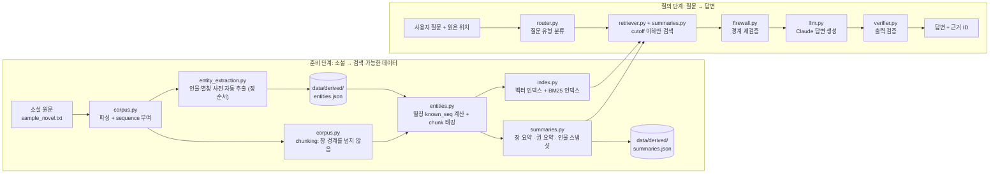
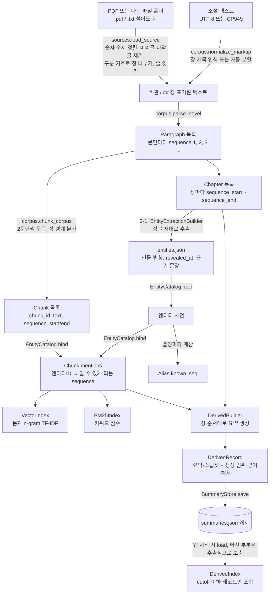
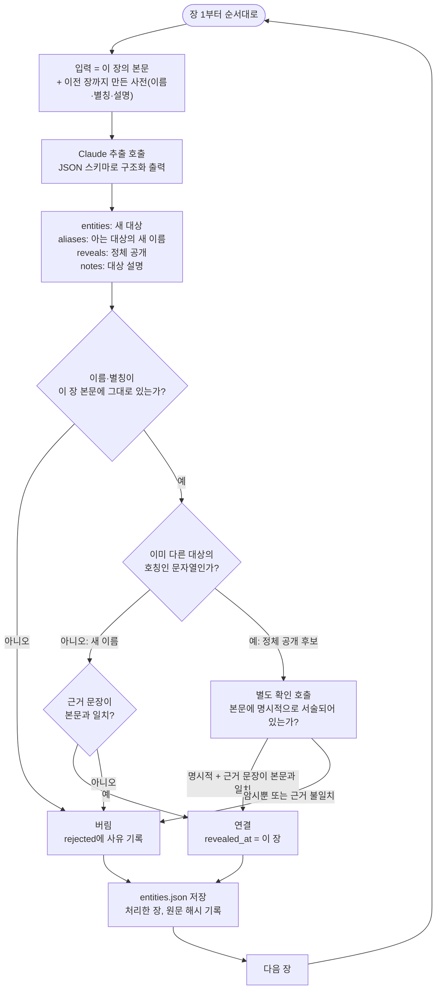
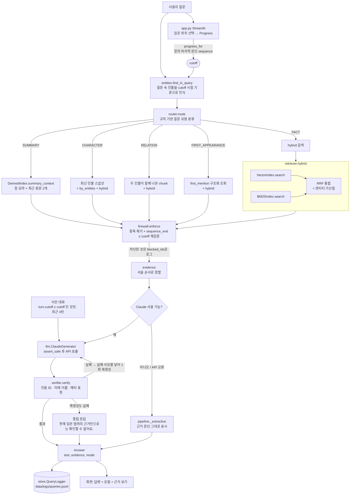
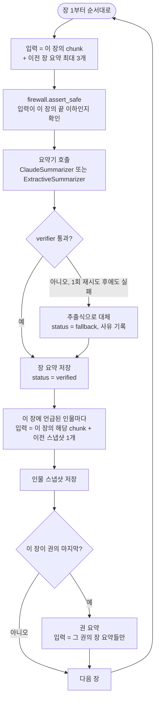
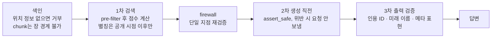

# 데이터 흐름 설명서: 소설과 질문이 응답이 되기까지

이 문서는 **소설 원문**과 **사용자의 질문**이 어떤 모듈과 기술을 거쳐 **답변**이 되는지, 각 단계에서 왜 그 기술을 골랐는지 설명합니다.
그래프는 Mermaid로 그렸습니다. GitHub에서는 그대로 보이고, VS Code에서는 Markdown 미리보기(Mermaid 지원 확장 포함)에서 보입니다.

핵심 원칙은 하나입니다. **독자가 읽은 위치(`cutoff`)보다 뒤의 정보는, 원문이든 요약이든 어떤 단계에서도 LLM에 닿지 않게 한다.**
아래의 모든 단계는 이 원칙을 지키려는 장치이거나, 이 원칙을 지키면서 답변 품질을 얻으려는 장치입니다.

---

## 1. 전체 그림

흐름은 두 갈래입니다. **준비 단계**(앱 시작 시, 또는 `build_summaries` 실행 시)에서 소설을 검색할 수 있는 형태로 가공해 두고, **질의 단계**(질문할 때마다)에서 그 결과를 읽은 위치까지만 꺼내 씁니다.

---

## 2. 준비 단계: 소설이 검색 가능한 데이터가 되기까지

준비 단계는 `python -m spoiler_rag.prepare`(또는 `run_app.bat`)가 실행합니다. 순서는 **구조 인식 → 인물·별칭 사전 자동 추출(2-1) → 색인 → 요약·스냅샷 생성(4)** 입니다. 파생 데이터는 작품마다 `data/derived/<소설 파일 이름>/`에 저장됩니다.

### 단계별 설명

| 단계 | 모듈 | 하는 일 | 이 기술을 쓴 이유 |
|---|---|---|---|
| PDF·나뉜 파일 | `sources.load_source` | 폴더면 .txt/.pdf 파일을 이름의 숫자 순서로 읽습니다. PDF는 `pypdf`로 쪽마다 글자를 뽑아 NFKC 정규화하고, 여러 쪽에 반복되는 머리글·바닥글(쪽 번호만 다른 줄 포함)과 첫 구분선 앞의 짧은 머리말을 뺀 뒤, 기호만 있는 줄을 장 경계로 삼고 쪽 너비에서 끊긴 줄을 문단으로 잇습니다. 파일들을 하나의 `#`/`##` 텍스트로 합치며, 한 작품을 나눈 파일이면 장 번호를 이어 매기고 권별 파일이면 파일 하나를 한 권으로 봅니다. | 이후 단계(파싱·sequence·firewall)를 하나도 바꾸지 않으려고 입력 형식 차이를 여기서 모두 흡수합니다. PDF는 장 번호가 본문에 없는 경우가 많아(위키문헌 인쇄본) 장 경계를 구분 기호로 찾고, 파일 이름·머리말의 "1장~20장"과 나눈 장 수가 다르면 경고합니다. 장 경계가 틀리면 진행도 경계가 틀리므로, 합친 본문을 `source_preview.txt`로 남겨 사람이 확인할 수 있게 합니다. |
| 구조 인식 | `corpus.normalize_markup`, `corpus.read_text_any` | `#`/`##` 표기가 없으면 "제1장", "1장", "Chapter 1", "프롤로그" 같은 장 제목 줄을 찾아 표기를 붙이고, 그것도 없으면 30문단씩 장으로 나눕니다. UTF-8과 CP949 파일을 모두 읽습니다. | 진행도와 스포일러 경계의 단위가 "장"이므로 장 구분은 반드시 있어야 합니다. 사용자가 원문을 손질하지 않고 그대로 넣을 수 있게 하려는 것입니다. 장 제목 규칙은 "3장의 편지를 받았다." 같은 본문 문장을 장 제목으로 오인하지 않도록 번호 뒤에 공백·구두점이나 줄 끝을 요구합니다. |
| 파싱 | `corpus.parse_novel` | `# N권`, `## N장`, 빈 줄 문단 형식을 읽어 **문단마다 1씩 늘어나는 `sequence`** 를 붙입니다. | 읽은 위치를 "N장까지"가 아니라 **하나의 정수 경계**로 바꾸면, 이후 모든 필터가 `sequence_end <= cutoff` 한 줄로 끝납니다. 장 제목 이전에 본문이 있으면 오류로 거부해 위치가 불분명한 데이터가 생기지 않게 합니다. |
| Chunking | `corpus.chunk_corpus` | 연속 2문단을 하나의 검색 단위로 묶되 **장 경계를 넘지 않습니다.** | 장 단위 진행도를 쓰므로, 두 장에 걸친 chunk가 있으면 "일부만 읽은 chunk"가 생겨 경계 판단이 모호해집니다. 애초에 만들지 않는 것이 가장 안전합니다. |
| 사전 자동 추출 | `entity_extraction.EntityExtractionBuilder` | 소설에서 인물·장소·집단·물건과 별칭, 정체 공개를 장 순서대로 뽑아 `entities.json`을 만듭니다. 자세한 흐름은 2-1. | 손으로 사전을 만들지 않고도 소설만 넣으면 동작하게 하려는 것입니다. 스포일러 안전을 위해 "늦게 적히는 쪽으로만 틀리도록" 설계했습니다. |
| 엔티티 사전 | `entities.EntityCatalog` | 인물·장소와 별칭을 관리합니다. 별칭마다 **독자가 그 연결을 알게 되는 시점 `known_seq`** 를 계산합니다. | 별칭 사전 자체가 스포일러가 될 수 있습니다. "회색 기사 = 카이든"을 정체 공개 전에 질의 확장에 쓰면 검색만으로 정체가 새어 나갑니다. `known_seq = max(별칭이 처음 나온 위치, revealed_at 장의 시작)` 으로 막습니다. |
| chunk 태깅 | `EntityCatalog.bind` | 각 chunk에 `mentions = {엔티티ID: 알 수 있게 되는 sequence}` 를 답니다. | 인물 질문에서 "이 인물이 나온 chunk"를 **텍스트 검색 없이 구조적으로** 찾기 위해서입니다. 이름이 바뀌어도(별칭) 같은 인물로 묶입니다. |
| 벡터 인덱스 | `index.VectorIndex` + `CharNgramTfidfEmbedder` | 단어에 경계 표시를 붙인 **문자 2·3-gram**을 해시해 TF-IDF 벡터를 만들고 코사인 유사도로 검색합니다. | 한국어는 조사·어미가 붙어 단어 형태가 달라집니다("리안이", "리안은"). 문자 n-gram은 형태소 분석기 없이도 이런 변형에 강합니다. 외부 모델 없이 바로 동작하는 **baseline**이며, `Embedder` 프로토콜로 신경망 임베딩에 교체할 수 있게 열어 두었습니다. |
| 키워드 인덱스 | `index.BM25Index` + `text.bm25_tokens` | 원형 단어와 조사를 뗀 형태를 함께 색인하고 BM25로 점수를 매깁니다. | 벡터는 의미에는 강하지만 **고유명사·정확한 문구**에는 약합니다. BM25가 그 빈틈을 채웁니다. |
| pre-filter | `_PositionalIndex` | 두 인덱스 모두 chunk를 `sequence_end` 순으로 정렬해 두고, 검색 시 **이분 탐색으로 후보를 먼저 자른 뒤** 점수를 계산합니다. BM25의 문서 빈도·평균 길이도 허용 범위 안에서만 셉니다. | "검색 후 걸러내기(post-filter)"는 top-k가 미래 chunk로 채워진 뒤 걸러져 결과가 비는 문제가 있고, 통계로 미래 정보가 순위에 스며들 수도 있습니다. 먼저 자르면 미래 chunk는 후보에조차 들어오지 않습니다. 위치 메타데이터가 없는 chunk는 **색인 자체를 거부**합니다. |
| 파생 데이터 생성 | `summaries.DerivedBuilder` | 장을 **순서대로** 처리하며 장 요약, 인물 스냅샷, (권이 끝나면) 권 요약을 만듭니다. 입력은 *그 장까지의 원문 + 이전 단계 산출물* 뿐입니다. | 전체 소설을 한 번에 넣고 "각 장을 요약하라"고 하면 모델이 미래를 알고 있어 앞 장 요약에 정체 공개나 결과가 섞입니다. 시점별로 입력을 제한해서 생성하면 이 오염이 구조적으로 불가능해집니다. |
| 생성 기록·캐시 | `DerivedRecord`, `SummaryStore` | 레코드마다 `generation_scope_end`, 근거 chunk ID, 모델, 프롬프트 버전, 생성 시각, 검증 상태, **그 시점까지의 원문 누적 해시**를 JSON에 저장합니다. | 사고가 났을 때 어떤 입력으로 만들었는지 추적할 수 있어야 합니다. 원문이 바뀌면 해시가 달라져 오래된 요약이 자동으로 폐기되므로, 낡은 캐시가 미래 정보를 품은 채 남는 일이 없습니다. |
| 생성 검증 | `summaries.DerivedBuilder._generate` + `verifier.verify` | 생성된 요약에 아직 접하지 않은 이름·미래 암시 표현이 있으면 1회 재생성하고, 실패하면 추출식으로 대체합니다. | LLM은 지시를 어길 수 있으므로, 프롬프트만 믿지 않고 결과를 코드로 한 번 더 검사합니다. |

### 2-1. 인물·별칭 사전 자동 추출

별칭 사전에서 가장 위험한 오류는 정체 공개 시점을 실제보다 **이르게** 적는 것입니다. 이르게 적히면, 공개 전에 "회색 기사"라는 질문이 카이든 관련 근거로 이어져 정체가 샙니다. 늦게 적히거나 빠지면 그 사이에 정보가 덜 나올 뿐입니다. 그래서 추출은 **늦게 적히는 쪽으로만 틀리도록** 만들었습니다.

| 장치 | 하는 일 | 이유 |
|---|---|---|
| 장 순서 입력 | N장을 처리할 때 모델에 주는 것은 N장 본문과 N-1장까지 만든 사전뿐입니다. | 모델이 N장 이후의 본문을 본 적이 없으므로 미래의 정체 공개를 "알 수" 없습니다. |
| 배운 장부터 연결 | 처음 등장한 이름까지 포함해 모든 호칭에 그것을 확인한 장을 `revealed_at`으로 적습니다. | `known_seq = max(본문 첫 등장, revealed_at 장의 시작)` 이므로, 추출이 늦으면 연결도 늦어질 뿐 이르게 되지는 않습니다. |
| 본문 대조 | 이름·별칭은 그 장 본문에 글자 그대로 있어야 하고, 근거 문장(quote)도 공백·따옴표만 정규화해 본문과 대조합니다. | 유명한 작품이라면 모델이 사전 지식으로 아직 나오지 않은 이름을 적을 수 있습니다. 본문에 없는 이름은 받지 않으므로 이를 막습니다. |
| 정체 공개 확인 | 이미 다른 대상의 호칭인 문자열을 새 대상에 연결하려면, 별도 확인 호출이 "본문에 명시적으로 서술됨"이라고 답하고 본문 그대로의 근거 문장을 내야 합니다. 두 호칭이 그 장에 함께 나와야 합니다. | 1권 2장의 "하벨이 회색 기사의 얼굴을 한참 바라봤다" 같은 **암시**는 정체 공개가 아닙니다. 추출 호출과 독립된 두 번째 판정으로 잘못된 연결을 한 번 더 거릅니다. |
| 장 단위 저장·중단 | 장마다 저장하고, API 오류가 나면 그 장에서 멈춥니다(다음 장으로 건너뛰지 않음). 다시 실행하면 그 장부터 이어서 합니다. | 장을 건너뛰면 "이전 장까지의 사전"이라는 전제가 깨집니다. 원문이나 프롬프트 버전이 바뀌면 처음부터 다시 만듭니다. |
| 시점별 표시 이름 | 대상의 이름을 사용자나 모델에 보여 줄 때는 `display_name(대상, cutoff)`로 그 시점에 아는 이름만 씁니다. 정식 이름이 아직 공개 전이면 먼저 알려진 호칭(예: "회색 기사")을 씁니다. | 대상에 닿는 것 자체는 유출이 아니지만, 정식 이름을 그대로 보여 주면 유출입니다. 이 장치가 있어서 "회색 기사"와 "카이든"을 한 대상으로 묶어도 안전합니다. |
| 정답 비교 | `prepare --compare 정답.json`이 연결마다 일치 / 늦음 / 누락 / 이른 연결(위험) / 정답에 없음을 보여 줍니다. | 자동 사전의 품질을 측정하는 수단입니다. 연결 "x ↔ y"의 시점은 두 이름을 모두 알게 되는 때(`max(known_seq)`)입니다. 대상에서 꺼내는 이름·태그가 모두 시점 제한을 받으므로, 한쪽 이름이 공개 전이면 연결은 드러나지 않습니다. |

`note`(대상 설명)는 다음 장 추출의 참고 자료로만 쓰고, 답변 생성에는 쓰지 않습니다. 사전이 바뀌면 사전 지문(`fingerprint`)이 달라져 요약·스냅샷 캐시도 자동으로 다시 만들어집니다.

---

## 3. 질의 단계: 질문이 답변이 되기까지

### 단계별 설명

| 단계 | 모듈 | 하는 일 | 이 기술을 쓴 이유 |
|---|---|---|---|
| 읽은 위치 → cutoff | `app.py`, `pipeline.progress_for`, `store.ProgressStore` | 사이드바에서 고른 "N권 M장까지 읽음"을 그 장의 **마지막 문단 sequence**(`cutoff`)로 바꾸고 JSON에 저장합니다. 읽지 않은 권·장의 제목은 화면에서 숨깁니다. | 이후 모든 단계가 이 정수 하나만 받으면 되므로 경계 로직이 한 곳에 모입니다. 장 제목도 스포일러일 수 있어 UI에서부터 숨깁니다. |
| 엔티티 인식 | `entities.find_in_query` | 질문에 나온 별칭 중 **cutoff 시점에 그 연결이 알려진 것만** 엔티티로 인식합니다. | 정체 공개 전에는 "회색 기사"를 카이든으로 확장하지 않습니다. 사용자가 미래의 이름을 직접 써도 그 이름은 인식되지 않아, 답변이 "그 이름을 안다"는 방향으로 흐르지 않습니다. |
| 질문 유형 분류 | `router.route` | 키워드 규칙으로 줄거리 요약 / 인물 / 관계 / 첫 등장 / 사실 질문으로 나눕니다. | 질문마다 필요한 근거가 다릅니다("줄거리"에는 요약, "관계"에는 두 인물이 함께 나온 문단). LLM으로 분류하면 질문 내용이 한 번 더 모델에 나가고 비용이 듭니다. 규칙이면 결정적이고 테스트하기 쉽습니다. 한계는 표현이 규칙에서 벗어나면 `FACT`로 떨어진다는 점입니다. |
| 요약 검색 | `DerivedIndex.summary_context` | cutoff 이하의 장 요약을 순서대로 가져오고, 장 요약이 많아지면 끝난 권은 권 요약으로 대체합니다. 아직 반영되지 않은 가장 최근 원문 2개를 덧붙입니다. | 긴 작품에서 원문 chunk를 고르게 뽑는 방식은 품질이 떨어집니다. 미리 만든 요약을 쓰면 입력이 짧아지고 사건 순서가 보존됩니다. |
| 인물 검색 | `DerivedIndex.latest_snapshot` + `retriever.by_entities` | 그 인물의 가장 최근(단, cutoff 이하) 상태 스냅샷과, 인물이 언급된 chunk를 서술 순서로 가져옵니다. | 스냅샷은 요약된 현재 상태, 원문 chunk는 그 상태의 증거입니다. 한 인물에 고정된 "최종 프로필"을 쓰지 않고 시점별 스냅샷을 쓰는 이유는, 최종 프로필에는 미래 정보가 들어 있기 때문입니다. |
| 관계·첫 등장 | `retriever.by_entities(require_all=True)`, `first_mention` | 두 인물이 **같은 chunk에 함께** 나온 곳, 또는 인물이 **처음** 언급된 chunk를 구조화 데이터로 찾습니다. | 이런 질문은 의미 검색보다 메타데이터 조회가 정확합니다. 첫 등장은 LLM 없이도 "1권 2장에서 처음 언급돼요."라고 바로 답할 수 있습니다. |
| 하이브리드 검색 | `retriever.hybrid` | 벡터와 BM25의 순위를 **RRF**(Reciprocal Rank Fusion, `1/(60+순위)`의 합)로 합치고, 질문의 엔티티가 들어 있는 chunk에 가산점을 줍니다. | 두 검색의 점수는 단위가 달라 직접 더할 수 없습니다. RRF는 순위만 쓰므로 점수 정규화가 필요 없습니다. 가산점에는 cutoff 시점에 알려진 엔티티 연결만 씁니다. |
| firewall | `firewall.enforce` | 모든 경로의 후보를 모아 중복을 없애고, **위치 정보가 없거나 `sequence_end > cutoff`인 것을 차단**합니다. 차단된 ID는 로그에 남깁니다. | 검색기마다 필터를 따로 두면 한 곳이 빠져도 모릅니다. 마지막에 **단일 지점**에서 다시 검사하면, 위의 어느 단계에 버그가 있어도 LLM에 닿기 전에 잡힙니다. 요약·스냅샷도 같은 `Chunk`로 변환되므로 같은 검사를 받습니다. |
| 근거 정렬 | `pipeline.ask` | 모델에는 근거를 **서술 순서**로, 화면에는 **관련도 순**으로 보여 줍니다. | 모델이 사건의 선후 관계를 올바르게 이해하게 하고, 사용자는 가장 관련 있는 근거를 먼저 보게 하려는 것입니다. |
| 대화 기록 격리 | `pipeline.ask` | 이전 대화 중 **생성 당시 cutoff가 현재 cutoff 이하인 턴만**, 최근 4턴까지 모델에 보냅니다. | 진행도를 뒤로 돌렸을 때, 앞서 더 멀리 읽은 상태에서 나눈 대화가 컨텍스트에 남아 있으면 그것이 스포일러가 됩니다(메모리 스포일러). 턴마다 cutoff를 저장해 두어 걸러냅니다. |
| 생성 직전 검사 | `llm.ClaudeGenerator.generate` | API 요청을 보내기 **직전에** `assert_safe`를 한 번 더 실행하고, 위반이면 요청 자체를 보내지 않고 예외를 냅니다. | 이 지점이 "미래 정보가 외부로 나가는" 마지막 관문입니다. 앞 단계가 모두 뚫려도 여기서 막습니다. |
| 답변 생성 | `llm.ClaudeGenerator` | 시스템 프롬프트(근거만 사용, 미래 암시 금지, 근거 ID 인용, 추론 표시, 모르면 중립 문구)와 `<evidence>`로 감싼 근거, 질문을 Claude(`claude-haiku-5-5`)에 보냅니다. | LLM은 근거를 자연스러운 문장으로 엮는 역할만 맡깁니다. 무엇을 보여 줄지는 앞 단계의 코드가 정하므로, 모델이 아는 작품 지식으로 새는 것은 프롬프트 규칙과 사후 검증으로 막습니다. |
| 출력 검증 | `verifier.verify` | ① 인용한 `[C0001]` 같은 ID가 실제 제공된 근거인지 ② cutoff 시점에 아직 접하지 않은 이름이 나오는지(질문에 사용자가 직접 쓴 이름은 제외) ③ "나중에 밝혀진다" 같은 미래 암시 표현이 있는지 검사합니다. | 프롬프트로 부탁하는 것만으로는 보장되지 않습니다. 코드로 검사해 실패하면 사유를 넣어 **1회 재생성**하고, 그래도 실패하면 중립 응답으로 바꿉니다. |
| 중립 응답 | `pipeline.NEUTRAL_ANSWER` | 답할 수 없을 때는 항상 "현재 읽은 범위의 근거만으로는 확인할 수 없어요." 한 문장만 씁니다. | "스포일러라서 말할 수 없어요"라고 하면 미래에 중요한 무언가가 있다는 사실 자체가 새어 나갑니다. 근거가 없을 때와 막았을 때가 같은 문장이어야 합니다. |
| 대체 경로 | `pipeline._extractive` | API 키가 없거나 호출이 실패하면 검색된 근거 문단을 그대로 보여 줍니다. | API 없이도 앱이 동작하고, 장애 때도 안전한(원문 그대로) 응답이 나갑니다. |
| 로그 | `store.QueryLogger` | 질문, cutoff, 질문 유형, 엔티티, 근거 ID, 차단 ID, 모드, 검증 문제를 JSONL로 남깁니다. | 스포일러 사고가 났을 때 원인(어느 근거가 들어갔는지)을 되짚기 위해서입니다. |

---

## 4. 요약·스냅샷 생성 흐름 (`prepare`의 두 번째 단계)

질의 때마다 만드는 것이 아니라 **미리 한 번 만들어 두는** 흐름입니다. 장 순서를 지키는 것이 핵심입니다.

- **재개 가능**: 레코드마다 파일에 저장하고, 이미 있는 유효한 레코드는 건너뜁니다.
- **자동 폐기**: 저장된 원문 해시가 현재 원문과 다르면(원문 수정) 그 레코드와 이후 레코드를 폐기합니다.
- **업그레이드**: 이전에 추출식으로 만든 레코드는 Claude로 다시 실행하면 교체됩니다.

---

## 5. 세 겹의 방어선

같은 목적의 검사를 단계마다 따로 둔 이유는, **한 곳의 버그나 모델의 실수가 곧바로 유출로 이어지지 않게** 하기 위해서입니다.

---

## 6. 모듈과 기술 한눈에 보기

| 모듈 | 역할 | 쓰는 기술·알고리즘 |
|---|---|---|
| `app.py` | 채팅 UI, 읽은 위치 선택, 대화 기록, 근거 표시, 사전 상태 표시 | Streamlit |
| `run_app.bat` | 더블클릭 실행: `prepare` 후 앱 시작 | Windows 배치 파일 |
| `config.py` | `.env` 로드(API 키, 소설 경로), 작품별 파생 데이터 경로 | 환경 변수 |
| `models.py` | `Paragraph`, `Chapter`, `Chunk`, `Progress`, `Turn` 자료구조 | dataclass |
| `text.py` | 한국어 단어 분리, 조사 제거, 문자 n-gram | 정규식, 규칙 기반(형태소 분석기 없음) |
| `corpus.py` | 장 제목 인식·자동 분할, 원문 파싱, sequence 부여, chunking | 규칙 기반 파서, 정규식 |
| `entity_extraction.py` | 인물·별칭 사전 자동 추출, 정답 사전 비교 | 장 순서 추출, Claude 구조화 출력(JSON 스키마), 본문 대조, 확인 호출 |
| `prepare.py` | 소설 준비 명령: 사전 추출 → 요약 생성, 이어서 하기 | CLI |
| `entities.py` | 엔티티·별칭 사전, 별칭의 공개 시점 계산, chunk 태깅 | 시점 인식(time-aware) 사전 |
| `index.py` | 벡터 인덱스, BM25 인덱스, pre-filter | 문자 n-gram TF-IDF, 코사인 유사도, BM25, 이분 탐색 |
| `retriever.py` | 하이브리드 검색, 엔티티 조회, 첫 언급, 최근 장면 | RRF(k=60), 엔티티 가산점 |
| `router.py` | 질문 유형 분류 | 키워드 규칙 |
| `firewall.py` | 진행도 경계 강제의 단일 지점 | 메타데이터 검사, 중복 제거 |
| `summaries.py` | 장·권 요약, 인물 스냅샷 생성·캐시·조회 | 시점별 순차 생성, 계층적 요약, 누적 해시 |
| `build_summaries.py` | 위 생성의 실행 명령 | CLI, 이어서 하기 |
| `llm.py` | Claude 호출, 시스템 프롬프트, 근거 포맷 | Anthropic SDK, `claude-haiku-5-5` |
| `verifier.py` | 출력·요약 검증 | 정규식, 금지어 사전, 시점별 이름 목록 |
| `pipeline.py` | 위 전부를 잇는 질의 흐름, 대체 경로, 로그 | 오케스트레이션 |
| `store.py` | 진행도 저장, 질의 로그 | JSON, JSONL |
| `cli.py` | 명령줄 질의 | argparse |

---

## 7. 예시: 같은 질문이 읽은 위치에 따라 달라지는 과정

질문: **"회색 기사는 누구야?"**

| | 1권 4장까지 읽은 독자 | 2권 4장까지 읽은 독자 |
|---|---|---|
| cutoff | 17 | 30 |
| 엔티티 인식 | "회색 기사"만 인식됩니다. 카이든과의 연결(`회색 기사` → 카이든)은 `known_seq`가 24라 cutoff 17보다 커서 **아직 알려지지 않은 것**으로 취급됩니다. | "회색 기사"가 카이든으로도 연결되어 두 엔티티가 함께 인식됩니다(`known_seq` 24 ≤ 30). |
| 질문 유형 | 인물 | 인물 |
| 검색 | 회색 기사의 스냅샷(1권 4장 시점)과, 회색 기사가 나온 1권 chunk들 | 카이든의 스냅샷(2권 3·4장 시점)과, 정체가 공개된 2권 chunk들 |
| firewall | 2권 chunk는 `sequence_end > 17`이라 후보에 오른 적도 없고, 올랐더라도 차단됩니다. | 통과 |
| 검증 | "카이든"이 답변에 나오면 **미래 이름으로 걸러져 재생성**됩니다. | 허용 |
| 결과 | "이름을 밝히지 않은 기사"까지만 답합니다. | 정체가 밝혀진 내용까지 답합니다. |

두 독자의 차이는 모델이 아니라 **`cutoff` 하나**에서 나옵니다. 그 값 하나가 인식, 검색, 검증을 모두 다르게 만듭니다.

---

## 8. 현재 한계 (정직하게)

- 벡터 검색은 문자 n-gram baseline이라 **의미가 비슷하지만 단어가 다른 질문**에는 약합니다. 신경망 임베딩과 reranker는 아직 없고, 검색 품질을 측정할 평가 세트도 아직 없습니다.
- 라우터와 검증기는 **규칙 기반**입니다. 간접적인 스포일러(이름 없이 결과만 암시)는 이름·표현 수준에서만 잡습니다.
- 사건 레코드와 관계 레코드는 아직 없습니다. 장 요약이 사건 목록을 대신합니다.
- 사전 자동 추출은 Claude가 있어야 하고, 실제 모델의 정확도는 `--compare`로 확인해야 합니다. 테스트는 규칙대로 동작하는 가짜 추출기와 일부러 틀리는 가짜 추출기로 했습니다. "등대", "일지" 같은 짧은 일반 명사 별칭은 다른 문맥에서도 걸려 검색 잡음이 생길 수 있습니다.
- 장 제목 자동 인식은 정규식 규칙이라 특이한 형식은 놓칠 수 있습니다.
- 진행도 단위는 **장**입니다(모델은 문단 단위를 지원하지만 UI는 아직 아닙니다).
