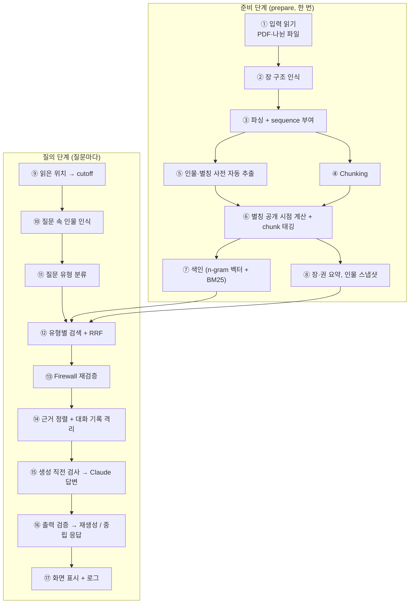
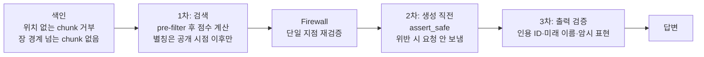

# 데이터 흐름별 적용 기술 정리 (발표용)

이 문서는 소설 원문이 들어와서 사용자에게 답변이 나가기까지의 과정을 **데이터가 흐르는 순서대로** 나누고, 단계마다 **어떤 기술을, 왜 썼는지** 정리한 것입니다.
모듈별 상세 동작은 [DATA_FLOW.md](../DATA_FLOW.md), 실험 결과는 [무정_테스트_보고서.md](무정_테스트_보고서.md)를 참고하세요.

---

## 0. 먼저 알아둘 것

### 설계 원칙 하나

> **독자가 읽은 위치(`cutoff`)보다 뒤의 정보는 원문이든 요약이든 어떤 단계에서도 LLM에 닿지 않게 한다.**

아래의 모든 기술 선택은 ① 이 원칙을 지키기 위한 장치이거나 ② 원칙을 지키면서 답변 품질을 얻기 위한 장치입니다.

### 기술 스택 한눈에 보기

| 구분 | 이름 | 쓰는 곳 |
|---|---|---|
| 언어·런타임 | Python 3.13 (conda 환경) | 전체 |
| 웹 프레임워크 | **Streamlit** | 채팅 UI, 읽은 위치 선택, 근거 표시 (`app.py`) |
| 외부 API / SDK | **Anthropic Python SDK** + Claude `claude-haiku-5-5` | 인물 사전 추출, 요약 생성, 답변 생성 |
| 라이브러리 | **pypdf** | PDF에서 글자 추출 (`sources.py`) |
| 테스트 | **pytest** | 105개 테스트 (스포일러 경계·사전·요약·입력 처리) |
| 표준 라이브러리 | `re`, `unicodedata`, `bisect`, `hashlib`, `zlib`, `json`, `dataclasses`, `argparse` | 파싱, 정규화, 검색 범위 자르기, 캐시 해시, 저장 |
| 직접 구현한 알고리즘 | 문자 n-gram TF-IDF, BM25, RRF, 규칙 기반 라우터·검증기·한국어 토크나이저 | 검색·분류·검증 |

외부 의존성은 4개(`anthropic`, `pypdf`, `streamlit`, `pytest`)뿐입니다. 검색 엔진과 벡터 DB, RAG 프레임워크(LangChain 등)는 쓰지 않고 직접 구현했습니다. 이유는 [5장](#5-쓰지-않은-기술과-그-이유)에 정리했습니다.

### 전체 흐름

---

## 1. 준비 단계: 소설 → 검색할 수 있는 데이터

실행: `python -m spoiler_rag.prepare` (또는 `run_app.bat`). 결과는 작품마다 `data/derived/<작품 이름>/`에 저장됩니다.

### ① 입력 읽기: PDF·여러 파일로 나뉜 소설

- **담당**: `spoiler_rag/sources.py`
- **기술**
  - [라이브러리] **pypdf** `PdfReader`로 쪽마다 글자 추출
  - [표준 라이브러리] `unicodedata.normalize("NFKC")`: `⼈` 같은 호환 문자 → `人`, 특수 공백 → 일반 공백
  - [자체 로직] 자연 정렬(`natural_key`): `무정2`가 `무정10`보다 앞에 오도록 파일 이름의 숫자를 수로 비교
  - [자체 로직] 머리글·바닥글 제거: 여러 쪽의 맨 위·아래에 반복되는 줄(쪽 번호만 다른 줄 포함)을 지움
  - [정규식] 장 구분선 인식: 글자 없이 기호만 있는 줄(`◆`, `* * *`), pypdf가 글리프 이름으로 내보낸 `/g0 /g0`
  - [자체 로직] 넓은 띄어쓰기 복원(`fix_wide_spacing`): 낱말 사이 2칸·문장부호 옆 1칸으로 뽑히는 PDF 보정
  - [자체 로직] 줄 잇기(`LineJoiner`): 문서 안의 낱말로 어휘를 만들고, "김 / 장로의"처럼 끊긴 두 줄을 붙일지 띄울지 판정
- **왜**
  - 실제 소설(위키문헌 『무정』 PDF 7개)은 장 번호가 본문에 없고, 쪽 너비에서 낱말 중간이 끊깁니다. 이 차이를 **입력 단계에서 모두 흡수**하면 뒤 단계(파싱·sequence·firewall)를 하나도 바꾸지 않아도 됩니다.
  - 장 경계가 틀리면 진행도 경계가 틀리므로, 합친 본문을 `source_preview.txt`로 남겨 사람이 확인할 수 있게 했습니다.

### ② 인코딩 처리와 장 구조 인식

- **담당**: `corpus.read_text_any`, `corpus.normalize_markup`
- **기술**
  - [표준 라이브러리] `utf-8-sig` → 실패하면 `cp949` 순서로 디코딩
  - [정규식] "제1장", "1장", "Chapter 1", "프롤로그" 같은 장 제목 줄 인식
  - [자체 로직] 장 제목이 하나도 없으면 30문단마다 장을 자동 분할
- **왜**
  - 한국어 Windows에서 만든 텍스트 파일은 CP949인 경우가 많습니다. 사용자가 파일을 손보지 않고 그대로 넣을 수 있게 했습니다.
  - 진행도 단위가 "장"이므로 장 구분은 반드시 있어야 합니다. 정규식은 "3장의 편지를 받았다." 같은 본문 문장을 제목으로 오인하지 않게 번호 뒤에 공백·구두점·줄 끝을 요구합니다.

### ③ 파싱과 sequence 부여

- **담당**: `corpus.parse_novel`, `models.py`
- **기술**
  - [자체 로직] `# N권`, `## N장`, 빈 줄 문단을 읽는 줄 단위 파서
  - [표준 라이브러리] `dataclasses` (`Paragraph`, `Chapter`는 `frozen=True`로 변경 불가)
  - [핵심 아이디어] **문단마다 작품 전체에서 1씩 늘어나는 정수 `sequence`**
- **왜**
  - "2권 3장까지 읽음"을 **정수 하나(`cutoff`)** 로 바꾸면, 이후 모든 필터가 `sequence_end <= cutoff` 한 줄로 끝납니다. 경계 로직이 한 곳에 모이고 테스트하기 쉬워집니다.
  - 장 제목 앞에 본문이 있으면 오류로 거부합니다. 위치를 알 수 없는 데이터를 만들지 않기 위해서입니다.

### ④ Chunking (검색 단위 나누기)

- **담당**: `corpus.chunk_corpus`
- **기술**: [자체 로직] 연속 2문단을 한 chunk로 묶되, **장 경계를 넘지 않음**. chunk마다 `sequence_start`, `sequence_end`를 기록
- **왜**: 두 장에 걸친 chunk가 있으면 "절반만 읽은 chunk"가 생겨 허용 여부가 모호해집니다. 그런 chunk를 애초에 만들지 않는 것이 가장 안전합니다.

### ⑤ 인물·별칭 사전 자동 추출

- **담당**: `spoiler_rag/entity_extraction.py`
- **기술**
  - [외부 API] **Anthropic SDK** + `claude-haiku-5-5`
  - [API 기능] **구조화 출력(JSON Schema)**: `output_config.format = {"type": "json_schema", ...}`로 `entities` / `aliases` / `reveals` / `notes` 형식의 JSON만 받음
  - [자체 로직] **장 순서 추출**: N장을 처리할 때 모델에 주는 것은 N장 본문 + N-1장까지 만든 사전뿐
  - [자체 로직] **본문 대조**: 이름·별칭과 근거 문장(quote)이 그 장 본문에 글자 그대로 있어야 받음
  - [자체 로직] **정체 공개 확인 호출**: "회색 기사 = 카이든" 같은 연결은 별도의 두 번째 호출이 "본문에 명시적으로 서술됨"이라고 답하고 근거 문장을 내야 받음
  - [표준 라이브러리] `hashlib.sha1` 누적 해시로 원문·프롬프트 변경 감지, 장마다 JSON 저장 → 중단 후 이어서 하기
- **왜**
  - 사람이 사전을 만들지 않아도 **소설만 넣으면 동작**하게 하려는 것입니다.
  - 사전에서 가장 위험한 오류는 정체 공개 시점을 **이르게** 적는 것입니다. 그래서 "늦게 적히는 쪽으로만 틀리도록" 설계했습니다. 모델이 미래 장을 본 적이 없고(장 순서), 유명 작품의 사전 지식으로 이름을 지어내도 본문에 없으면 버려지며(본문 대조), 암시만 있는 장면은 확인 호출에서 걸러집니다.
  - 자유 텍스트 대신 JSON Schema를 쓰면 응답을 코드로 바로 검증할 수 있고, 형식 오류로 인한 파싱 실패가 없습니다.

### ⑥ 별칭 공개 시점 계산과 chunk 태깅

- **담당**: `entities.EntityCatalog.bind`
- **기술**
  - [자체 로직] 별칭마다 `known_seq = max(별칭이 본문에 처음 나온 위치, revealed_at 장의 시작)` 계산
  - [자체 로직] chunk마다 `mentions = {인물ID: 독자가 이 연결을 알게 되는 sequence}` 기록
  - [표준 라이브러리] 사전 내용의 `sha1` 지문(`fingerprint`) → 사전이 바뀌면 요약 캐시도 자동으로 다시 생성
- **왜**
  - **별칭 사전 자체가 스포일러**가 될 수 있습니다. 정체 공개 전에 "회색 기사" 질문을 카이든으로 확장하면 검색만으로 정체가 샙니다. `known_seq`가 그 연결을 시점에 묶어 둡니다.
  - 인물 질문에서 "이 인물이 나온 chunk"를 텍스트 검색 없이 구조적으로 찾을 수 있습니다.

### ⑦ 색인: 문자 n-gram 벡터 + BM25

- **담당**: `spoiler_rag/index.py`, `spoiler_rag/text.py`
- **기술**
  - [알고리즘] **문자 2·3-gram TF-IDF 벡터 + 코사인 유사도** (`CharNgramTfidfEmbedder`)
    - [기법] 해싱 트릭: n-gram을 `zlib.crc32`로 2¹⁸차원에 대응 (Python `hash()`는 실행마다 값이 달라 쓰지 않음)
  - [알고리즘] **BM25** (`k1=1.5`, `b=0.75`)
  - [자체 로직] 한국어 토크나이저: 형태소 분석기 없이 정규식으로 단어를 나누고, 조사 목록으로 "리안이" → "리안"을 만들어 **원형과 함께** 색인
  - [표준 라이브러리] **`bisect` 이분 탐색 pre-filter** (`_PositionalIndex`): chunk를 `sequence_end` 순으로 정렬해 두고, 검색할 때 cutoff 이하 개수를 먼저 구해 **그 범위 안에서만 점수 계산**. BM25의 문서 빈도·평균 길이도 그 범위에서만 셈
- **왜**
  - 한국어는 조사·어미가 붙어 같은 이름도 형태가 달라집니다. 문자 n-gram은 형태소 분석기 없이 이런 변형에 강하고, 외부 모델 없이 바로 동작하는 baseline입니다.
  - 벡터 검색은 고유명사·정확한 문구에 약하므로 BM25로 빈틈을 채웁니다.
  - **pre-filter가 이 프로젝트의 핵심입니다.** 검색 후 걸러내는 방식(post-filter)은 top-k가 미래 chunk로 채워졌다가 걸러져 결과가 비고, IDF 같은 통계에 미래 정보가 섞입니다. 먼저 자르면 미래 chunk는 후보에조차 오르지 않습니다. 위치 정보가 없는 chunk는 색인 자체를 거부합니다.

### ⑧ 장 요약 · 권 요약 · 인물 시점별 스냅샷

- **담당**: `spoiler_rag/summaries.py`
- **기술**
  - [자체 로직] **시점별 순차 생성**: 장 1부터 순서대로, 입력은 "그 장의 원문 + 이전 장 요약 최대 3개"뿐
  - [자체 로직] **계층적 요약**: 장 요약 → (권이 끝나면) 권 요약, 인물 스냅샷은 "이번 장 원문 + 직전 스냅샷 1개"로 갱신
  - [외부 API] `ClaudeSummarizer` / [대체] `ExtractiveSummarizer` (API 없이 원문 문장을 골라 근거 ID를 붙임)
  - [자체 로직] 생성 결과를 ⑯과 같은 검증기로 검사 → 1회 재생성 → 실패하면 추출식으로 대체
  - [데이터 설계] `DerivedRecord`에 `generation_scope_end`, 근거 chunk ID, 모델, 프롬프트 버전, 원문 누적 해시(`sha1`) 기록 → JSON 캐시
  - [데이터 설계] 요약 레코드를 원문과 같은 `Chunk` 형식으로 변환 (`sequence_end = generation_scope_end`)
- **왜**
  - 전체 소설을 넣고 "장별로 요약하라"고 하면 모델이 결말을 알고 있어 앞 장 요약에 정체 공개가 섞입니다. **입력을 시점별로 제한하면 이 오염이 구조적으로 불가능**해집니다.
  - 긴 작품에서 "지금까지 줄거리"를 원문 chunk로 답하면 근거가 너무 많고 품질이 떨어집니다. 미리 만든 요약이 짧고 사건 순서를 보존합니다.
  - 요약을 `Chunk`로 바꾸면 **원문과 똑같은 firewall·검증기를 통과**합니다. 방어 코드를 새로 만들 필요가 없습니다.
  - 원문이 바뀌면 해시가 달라져 오래된 요약이 자동으로 폐기됩니다. 낡은 캐시가 미래 정보를 품은 채 남지 않습니다.

---

## 2. 질의 단계: 질문 → 답변

### ⑨ 읽은 위치 → cutoff

- **담당**: `app.py`, `pipeline.progress_for`, `store.ProgressStore`
- **기술**
  - [프레임워크] **Streamlit**: 사이드바에서 권·장 선택, `st.chat_message`/`st.chat_input` 채팅, `st.session_state`로 대화 기록 유지, `st.cache_resource`로 색인·클라이언트를 한 번만 생성
  - [자체 로직] "N권 M장까지" → 그 장의 마지막 문단 `sequence` = `cutoff`
  - [저장] JSON 파일에 사용자별 진행도 저장
- **왜**
  - Streamlit은 파이썬만으로 채팅 UI를 빠르게 만들 수 있어 프로토타입에 적합합니다. 색인을 `cache_resource`로 두면 질문할 때마다 다시 만들지 않습니다.
  - **아직 읽지 않은 장의 제목은 화면에서 숨깁니다.** 장 제목("마지막 등불")도 스포일러가 될 수 있기 때문입니다.

### ⑩ 질문 속 인물 인식

- **담당**: `entities.find_in_query`
- **기술**: [자체 로직] 질문에 나온 별칭 중 `known_seq <= cutoff`인 연결만 인물로 인식
- **왜**: 정체 공개 전에는 "회색 기사"를 카이든으로 확장하지 않습니다. 사용자가 미래의 이름을 직접 입력해도 인식되지 않으므로, 시스템이 "그 이름을 안다"는 반응을 보이지 않습니다.

### ⑪ 질문 유형 분류 (라우터)

- **담당**: `spoiler_rag/router.py`
- **기술**: [자체 로직] **키워드 규칙** + `Enum` → 줄거리 요약 / 인물 / 관계 / 첫 등장 / 사실 질문
- **왜**
  - 질문마다 필요한 근거가 다릅니다("줄거리"엔 요약, "관계"엔 두 인물이 함께 나온 문단).
  - LLM으로 분류하면 호출이 한 번 늘어 비용·지연이 생기고 결과가 매번 달라질 수 있습니다. 규칙은 결정적이고 테스트하기 쉽습니다.
  - 한계: 규칙에 없는 표현은 "사실 질문"으로 떨어집니다(『무정』 평가에서 2건 오분류).

### ⑫ 유형별 검색 + 하이브리드 순위 통합

- **담당**: `pipeline.retrieve`, `retriever.py`, `summaries.DerivedIndex`
- **기술**

  | 질문 유형 | 검색 방법 |
  |---|---|
  | 줄거리 요약 | cutoff 이하의 장 요약(많으면 끝난 권은 권 요약으로 대체) + 최근 원문 2개 |
  | 인물 | cutoff 이하의 최신 인물 스냅샷 + 그 인물이 나온 chunk + 하이브리드 |
  | 관계 | 두 인물이 **같은 chunk에 함께** 나온 곳 + 하이브리드 |
  | 첫 등장 | 인물이 **처음** 언급된 chunk(구조화 조회) + 하이브리드 |
  | 사실 | 하이브리드 |

  - [알고리즘] **RRF (Reciprocal Rank Fusion)**: 벡터 결과와 BM25 결과의 순위를 `1 / (60 + 순위)`로 합산
  - [자체 로직] 질문 속 인물이 들어 있는 chunk에 가산점 (cutoff 시점에 알려진 연결만 사용)
- **왜**
  - 관계·첫 등장 질문은 의미 검색보다 **메타데이터 조회가 정확**합니다. 첫 등장은 LLM 없이도 "1권 2장에서 처음 언급돼요."라고 답할 수 있습니다.
  - 코사인 유사도와 BM25 점수는 단위가 달라 직접 더할 수 없습니다. RRF는 순위만 쓰므로 점수 정규화가 필요 없고 구현이 단순합니다.
  - 인물 정보는 "최종 프로필"이 아니라 **시점별 스냅샷**을 씁니다. 최종 프로필에는 미래 정보가 들어 있기 때문입니다.

### ⑬ Firewall 재검증

- **담당**: `spoiler_rag/firewall.py`
- **기술**: [자체 로직] 모든 검색 경로의 후보를 한곳에 모아 중복 제거 후, **위치 정보가 없거나 `sequence_end > cutoff`인 것을 차단**. 차단된 ID는 로그에 기록
- **왜**: 검색기마다 필터를 따로 두면 한 곳이 빠져도 알 수 없습니다. LLM 직전의 **단일 지점**에서 다시 검사하면, 앞 단계에 버그가 있어도 여기서 잡힙니다. 요약·스냅샷도 `Chunk`이므로 같은 검사를 받습니다.

### ⑭ 근거 정렬과 대화 기록 격리

- **담당**: `pipeline.ask`, `models.Turn`
- **기술**
  - [자체 로직] 모델에는 근거를 **서술 순서**로, 화면에는 **관련도 순**으로 전달
  - [자체 로직] 대화 턴마다 생성 당시의 `cutoff`를 저장하고, **현재 cutoff 이하에서 생성된 턴만** 최근 4턴까지 모델에 보냄
- **왜**
  - 서술 순서로 주면 모델이 사건의 선후를 올바르게 이해합니다.
  - 진행도를 뒤로 돌렸을 때, 더 멀리 읽은 상태에서 나눈 대화가 문맥에 남아 있으면 그것이 스포일러가 됩니다(**메모리 스포일러**). 턴별 cutoff로 걸러냅니다.

### ⑮ 생성 직전 검사 → Claude 답변 생성

- **담당**: `spoiler_rag/llm.py`
- **기술**
  - [자체 로직] API 요청 직전에 `firewall.assert_safe` 한 번 더 실행 → 위반이면 **요청을 보내지 않고** 예외 발생
  - [외부 API] Anthropic SDK `messages.create`, 모델 `claude-haiku-5-5`, `effort: medium`
  - [프롬프트 설계] 시스템 프롬프트 규칙 8개(근거만 사용, 미래 암시 금지, 근거 ID `[C0001]` 인용, 추론은 "(추론)" 표시, 모르면 정해진 중립 문구), XML 태그(`<reader_progress>`, `<evidence>`, `<question>`)로 입력 구분
- **왜**
  - 이 지점이 "미래 정보가 외부로 나가는" **마지막 관문**입니다.
  - LLM에는 "근거를 자연스러운 문장으로 엮는 역할"만 맡깁니다. 무엇을 보여 줄지는 앞 단계의 코드가 정합니다.
  - Haiku는 빠르고 저렴해서 질문마다 호출하는 대화형 서비스에 맞습니다(『무정』 평가: 질문당 평균 5.6초).
  - XML 태그로 근거와 질문을 나누면 모델이 지시와 자료를 혼동하지 않습니다.

### ⑯ 출력 검증 → 재생성 / 중립 응답

- **담당**: `spoiler_rag/verifier.py`, `pipeline._generate`
- **기술**
  - [정규식] 답변에 인용된 `[C0001]`·`[S0001]` 등이 **실제로 제공한 근거인지** 검사
  - [자체 로직] cutoff 시점에 아직 나오지 않은 이름(`future_terms`)이 답변에 있는지 검사 (질문에 사용자가 직접 쓴 이름은 제외)
  - [금지어 사전] "나중에 밝혀", "결말", "후반부", "스포일러" 같은 미래 암시 표현 검사
  - [자체 로직] 실패하면 **실패 사유를 프롬프트에 넣어 1회 재생성**, 그래도 실패하면 중립 응답
- **왜**
  - 프롬프트로 부탁하는 것만으로는 보장되지 않으므로, 결과를 **코드로 한 번 더** 검사합니다.
  - 중립 응답은 항상 "현재 읽은 범위의 근거만으로는 확인할 수 없어요." 한 문장입니다. "스포일러라서 말할 수 없어요"라고 하면 **미래에 무언가 있다는 사실 자체**가 새어 나가기 때문에, 근거가 없을 때와 막았을 때가 같은 문장이어야 합니다.

### ⑰ 대체 경로, 화면 표시, 로그

- **담당**: `pipeline._extractive`, `app.py`, `store.QueryLogger`
- **기술**
  - [자체 로직] API 키가 없거나 호출이 실패하면 검색된 근거 문단을 그대로 표시
  - [프레임워크] Streamlit: 답변, 질문 유형, 생성 모드, 근거(권·장, ID)를 펼쳐 보기로 표시
  - [저장] **JSON Lines** 로그 (`data/logs/queries.jsonl`): 질문, cutoff, 유형, 근거 ID, 차단 ID, 검증 문제
- **왜**
  - API 없이도 앱이 동작하고, 장애 때도 안전한(원문 그대로) 응답이 나갑니다.
  - 근거를 보여 주면 사용자가 답을 직접 확인할 수 있습니다.
  - 스포일러 사고가 나면 어떤 근거가 들어갔는지 되짚을 수 있어야 합니다. JSONL은 한 줄에 한 질의라 이어 쓰기와 분석이 쉽습니다.

---

## 3. 방어선을 겹겹이 둔 이유

같은 목적의 검사를 여러 단계에 둔 것은 **한 곳의 버그나 모델의 실수가 곧바로 유출로 이어지지 않게** 하기 위해서입니다.

| 방어선 | 막는 것 | 적용 단계 |
|---|---|---|
| 데이터 구조 | 위치를 알 수 없는 데이터, 경계에 걸친 chunk | ③ ④ ⑦ |
| 시점 제한 생성 | 사전·요약에 미래 정보가 섞이는 것 | ⑤ ⑧ |
| 시점별 별칭 | 별칭 연결로 정체가 새는 것 | ⑥ ⑩ ⑫ |
| pre-filter + firewall | 미래 원문·요약이 근거로 들어가는 것 | ⑦ ⑬ ⑮ |
| 대화 격리 | 이전 대화를 통한 유출 | ⑭ |
| 출력 검증 + 중립 응답 | 모델의 사전 지식·암시 표현 | ⑯ |

---

## 4. 검증과 평가에 쓴 기술

| 대상 | 기술 | 내용 |
|---|---|---|
| 스포일러 경계 | **pytest** | 샘플 소설의 모든 cutoff에서 근거가 `sequence_end <= cutoff`인지, 별칭이 공개 전에 연결되지 않는지, 진행도를 되돌리면 대화가 격리되는지 |
| 사전 자동 추출 | pytest + **가짜 추출기** | 규칙대로 동작하는 가짜 추출기와 **일부러 틀리는** 가짜 추출기(본문에 없는 이름, 암시를 정체 공개로 착각)로 거부 장치 확인. 실제 API 호출 없음 |
| 사전 품질 | `prepare --compare` | 자동 사전을 손으로 만든 정답 사전과 비교: 일치 / 늦음 / 누락 / **이른 연결(위험)** |
| 실제 작품 | `scripts/eval_mujeong.py` | 『무정』 126장, 질문 33개. 이름·사건 12개가 처음 나오는 장을 측정해 두고, 읽은 장보다 뒤의 용어가 근거나 답에 있으면 유출로 자동 판정 |

『무정』 평가 결과(2026-10-15): **스포일러 유출 0건**(33개 중), 스포일러 유도 질문 13개 모두 중립 응답, 일반 질문 16개 중 정답 8·부분 3·답 못 함 5(지어낸 답 없음). 자세한 내용은 [무정_테스트_보고서.md](무정_테스트_보고서.md).

---

## 5. 쓰지 않은 기술과 그 이유

발표 질의응답에 대비해, 흔히 쓰는 기술을 쓰지 않은 이유를 정리했습니다.

| 쓰지 않은 것 | 이유 |
|---|---|
| 벡터 DB (FAISS, Chroma 등) | 스포일러 방지의 핵심은 **점수 계산 전에** 범위를 자르는 것입니다. 근사 최근접 검색 DB는 "검색 후 필터"가 되기 쉽고, 소설 한 편 규모의 chunk는 메모리에서 전수 계산해도 충분히 빠릅니다. |
| RAG 프레임워크 (LangChain 등) | 검색 → firewall → 생성 직전 검사 → 출력 검증의 각 지점을 직접 통제해야 합니다. 프레임워크의 추상화가 그 경계를 가리면 유출 지점을 확인하기 어렵습니다. |
| 형태소 분석기 (KoNLPy 등) | 설치가 무겁고(Java 의존 등) 소설의 고유명사를 잘못 자를 수 있습니다. 문자 n-gram + 조사 제거로 대부분의 변형을 처리합니다. |
| LLM 기반 질문 분류 | 호출이 한 번 늘어 비용·지연이 생기고, 결과가 매번 달라 테스트하기 어렵습니다. |
| 신경망 임베딩 (현재) | baseline을 먼저 세우고 평가하기 위해서입니다. `Embedder` 인터페이스로 교체할 수 있게 열어 두었고, 다음 작업으로 확정됐습니다(아래). |
| `python-dotenv` | `.env` 읽기는 20줄 정도로 직접 구현해 의존성을 줄였습니다. |

### 다음 작업 (예정, 아직 구현 전)

『무정』 평가에서 "어디서 공부해?" ↔ 본문 "시카고"처럼 **질문과 본문의 표현이 다른 서술형 질문**을 문자 n-gram이 찾지 못했습니다. 그래서 신경망 임베딩(뜻 유사도)을 추가하고, **질문 유형에 따라 검색 방식을 고르는** 방식(`auto`)을 도입할 예정입니다.

| 질문 | 검색 방식 |
|---|---|
| 인물, 첫 등장, 문구 인용 | 문자 n-gram + BM25 (글자 일치가 정확) |
| 관계, 서술형 사실 | 신경망 임베딩 + BM25 (뜻으로 찾아야 함) |

신경망 검색도 같은 pre-filter(`_PositionalIndex`)를 거치게 해서 스포일러 안전 원칙은 그대로 유지합니다.

---

## 6. 발표 슬라이드용 한 장 요약

| 순서 | 단계 | 핵심 기술 | 한 줄 이유 |
|---|---|---|---|
| ① | 입력 읽기 | pypdf, NFKC 정규화, 줄 잇기 로직 | 실제 PDF의 형식 차이를 입구에서 흡수 |
| ② | 장 구조 인식 | 정규식, UTF-8/CP949 | 원문을 손대지 않고 넣기 |
| ③ | 파싱 | 문단별 정수 `sequence` | 진행도를 정수 하나로 표현 |
| ④ | Chunking | 2문단, 장 경계 불가 | 경계에 걸친 chunk 원천 차단 |
| ⑤ | 사전 추출 | Claude + JSON Schema, 장 순서, 본문 대조, 확인 호출 | 자동화 + 늦게만 틀리기 |
| ⑥ | 별칭 시점 | `known_seq` | 사전 자체가 스포일러가 되지 않게 |
| ⑦ | 색인 | 문자 n-gram TF-IDF + BM25, bisect pre-filter | 한국어 변형 대응 + 미래 chunk는 후보에도 없음 |
| ⑧ | 요약·스냅샷 | 시점별 순차 생성, 계층 요약, 해시 캐시 | 요약에 미래가 섞이지 않게 |
| ⑨ | cutoff | Streamlit, JSON 저장 | 읽지 않은 장 제목도 숨김 |
| ⑩ | 인물 인식 | 시점 제한 별칭 매칭 | 미래 이름은 인식하지 않음 |
| ⑪ | 라우터 | 키워드 규칙 | 결정적·저비용 |
| ⑫ | 검색 | 구조화 조회 + RRF(k=60) | 유형별로 맞는 근거 |
| ⑬ | Firewall | 단일 지점 재검증 | 앞 단계 버그 대비 |
| ⑭ | 대화 격리 | 턴별 cutoff | 메모리 스포일러 차단 |
| ⑮ | 답변 생성 | `assert_safe` → Claude Haiku, 규칙 프롬프트 | 마지막 관문 + 빠르고 저렴 |
| ⑯ | 출력 검증 | 정규식·금지어·미래 이름 → 재생성 → 중립 응답 | 프롬프트만 믿지 않음 |
| ⑰ | 표시·로그 | Streamlit, JSONL | 근거 확인, 사고 추적 |
